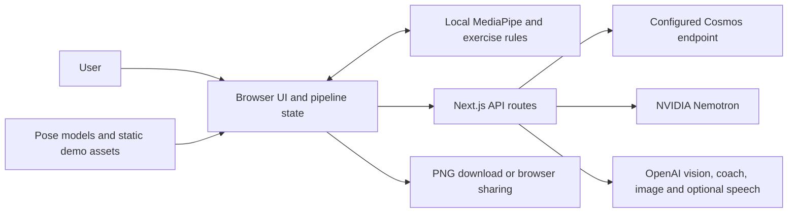
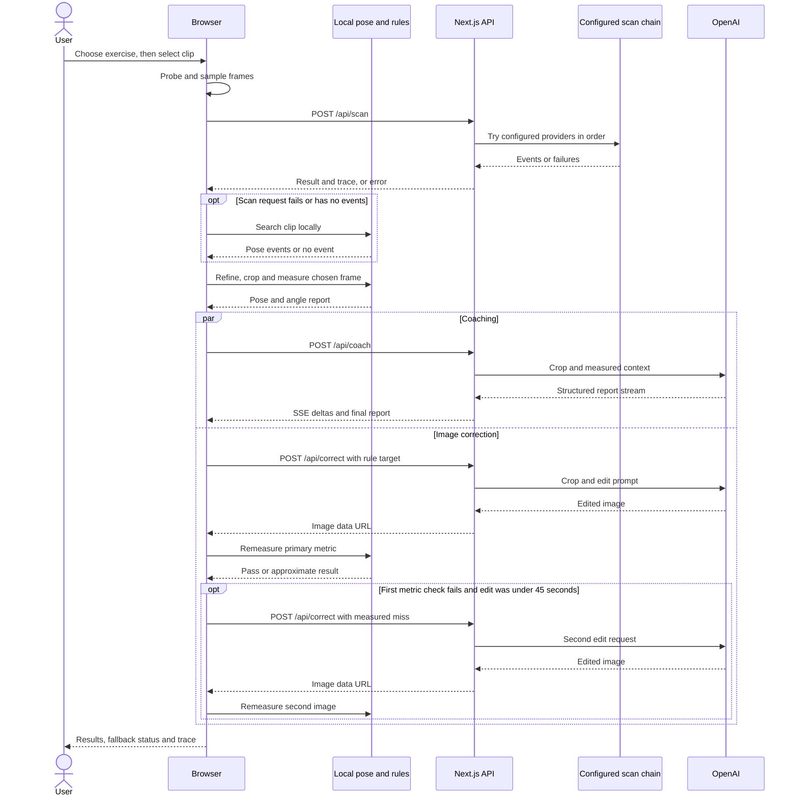

# System Architecture: Gym Bro

## Overview

Gym Bro is a Next.js web application that analyses a short exercise video. The browser reads the clip, extracts frames, runs MediaPipe pose detection and computes exercise-specific measurements. Server routes send selected images and measurements to configured AI providers for moment selection, coaching and a corrected-form illustration. Results include a before/after comparison, measurement overlays, a 3D pose replay and a downloadable image.

The system is one application with browser and server modules. It has no application database, account system, message broker or saved-session service. This document describes the source at commit [`90fc50bd7a1620e48b9f94530bb4f123495cf5e0`](https://github.com/MasteraSnackin/Gymbro/commit/90fc50bd7a1620e48b9f94530bb4f123495cf5e0). It records implemented behaviour and configuration, not evidence of a deployment, provider availability or validated exercise advice.

## Key requirements

- Accept a browser-decodable MP4, MOV, M4V or WebM clip. The browser rejects empty files, files over 200 MiB and clips longer than 60 seconds.
- Support squat, bench press, deadlift, overhead press, biceps curl and pull-up analysis, with an automatic exercise choice when a scan provider returns one.
- Select a moment, measure visible joints against exercise rules, explain the result and show a target-form illustration or skeleton fallback.
- Keep pose detection and measurement in the browser, while keeping provider credentials on the server.
- Bound frame counts, request sizes, provider attempts and selected operations with timeouts. These are implementation limits; no throughput or latency target has been demonstrated.
- Show which provider or fallback produced a result, and distinguish cached fixtures from live analysis.
- Allow local export and sharing without requiring an account or persistent server storage.

The input limits are defined in [`probe.ts`](src/lib/video/probe.ts). API contracts and payload limits are defined separately in [`schemas.ts`](src/lib/schemas.ts); direct API requests do not inherit every browser-side limit.

## High-level architecture

The browser owns the analysis session and orchestrates the workflow. It calls API routes in the same Next.js application. The scan route tries configured providers in order: Cosmos, NVIDIA Nemotron, then OpenAI vision. Coaching, image editing and optional server speech use OpenAI. If the scan request fails, the browser can scan poses locally. Static rules provide coaching when the coach call fails, and a target skeleton replaces the image when editing fails.

The diagram shows the browser/server boundary and the external services that can receive media or derived data. Local pose inference does not make the whole workflow local: live scan, coach and image requests send selected images through the server.

An [interactive architecture map](docs/diagrams/gymbro.architecture.html) provides component inspection and route tracing. GitHub displays the HTML source; download it and open it locally to use the controls. Its [JSON model](docs/diagrams/gymbro.architecture.json) is editable, and its [validation receipt](docs/diagrams/gymbro.architecture.receipt.json) records diagram checks rather than application or provider acceptance.

## Component details

### Web client and pipeline orchestration

The App Router pages in [`src/app`](src/app) render the landing, analysis and development views. React 19, TypeScript, Tailwind CSS and the UI components handle upload controls, progress, results and error states. The analysis page also generates the result PNG and uses the Web Share API, clipboard or download as available.

[`usePipeline.ts`](src/hooks/usePipeline.ts) coordinates probing, sampling, scanning, moment selection, refinement, pose detection, coaching, correction and remeasurement. It uses an `AbortController` to cancel work when another run starts or the analysis page is left. Retrying most stages restarts the run; correction and verification have a narrower retry path. A live run can also analyse another event returned by the scan.

[`pipeline.ts`](src/lib/store/pipeline.ts) holds Zustand state in browser memory: the selected `File`, video URL, sampled frames, chosen moment, pose landmarks, reports, images, progress and trace entries. It does not use persistence middleware, local storage or a server session. A page reload loses an uploaded analysis. Starting over clears the store and revokes its video blob URL; this is not a guarantee that every browser allocation or provider copy has been deleted.

### Video sampling and pose analysis

The browser uses HTML video and canvas APIs to probe codecs, seek through the clip, sample timestamped JPEGs and crop the chosen frame. The live scan samples at a requested 4 frames per second, capped at 40 frames with a 448-pixel long edge. It reduces the frame payload towards a 3.8 MiB budget and creates a contact sheet for the OpenAI fallback. The normal upload flow sends these images, not the original video file.

MediaPipe Tasks Vision runs locally in two modes: a heavy image model for the selected frame and corrected image, and a lite video model for refinement, pose-only scanning and 3D replay capture. The loader tries local assets with GPU, then CPU, followed by remote assets with GPU, then CPU. Remote fallbacks use jsDelivr for the WebAssembly runtime and Google storage for models. They fetch runtime assets; this code does not send the exercise frames to those asset hosts for inference.

The pose result contains 33 normalised landmarks and corresponding world landmarks for the selected lifter. Geometry and exercise rules produce an `AngleReport`. Measurements depend on the inferred movement phase, camera view and landmark visibility. Unsupported views, missing joints and visibility below 0.5 produce unmeasurable values that do not reduce the score. Most measurements use image geometry; some metrics use world landmarks when available. These checks do not establish biomechanical or clinical accuracy.

Sources: [`video`](src/lib/video), [`pose`](src/lib/pose), [`compute.ts`](src/lib/angles/compute.ts), [`rules.ts`](src/lib/exercises/rules.ts), [`score.ts`](src/lib/exercises/score.ts) and [`refine.ts`](src/lib/moments/refine.ts).

### API boundary

The API is a set of dynamic Node.js route handlers in the same Next.js application, rather than a separate gateway service. POST handlers read JSON, enforce a body limit of `4.4 * 1024 * 1024` bytes, then validate requests with Zod. The helper rejects oversized declared or actual bodies with HTTP 413, invalid JSON with HTTP 400, and schema failures with HTTP 400. If no useful `Content-Length` is present, the helper reads the body before checking its byte length.

| Route | Responsibility | Response |
| --- | --- | --- |
| `POST /api/scan` | Validate sampled frames and run the configured scan chain | Scan result with events, raw model text and attempt trace |
| `POST /api/pick-frame` | Run OpenAI vision directly on a contact sheet | Scan-shaped result with a fallback trace |
| `POST /api/coach` | Generate a structured coaching report | Server-sent `delta`, `done` or `error` events |
| `POST /api/correct` | Edit the cropped image using the requested pose target | Image data URL, model, elapsed time and prompt details |
| `POST /api/tts` | Generate speech if a server TTS model is configured | MP3 audio, or HTTP 501 so the browser can use speech synthesis |
| `GET /api/health` | Report fixture flags and provider configuration | JSON; optional limited provider probes with `?probe=1` |

The scan request schema permits up to 40 frames, a duration up to 120 seconds and an effective frame rate up to 10. This differs from the browser's 60-second clip limit. It also accepts an optional video data URL, although the normal client pipeline does not supply one. Image fields are checked for a data URL prefix; this is not complete image-content validation. The standalone pick-frame route exists, but the normal pipeline uses the OpenAI fallback within `/api/scan`.

JSON and audio responses use `Cache-Control: no-store`. Coaching streams also disable transformation and request proxy buffering to be disabled. The routes do not implement application authentication, authorisation or rate limiting.

Sources: [`schemas.ts`](src/lib/schemas.ts), [`respond.ts`](src/app/api/_lib/respond.ts) and [`API routes`](src/app/api).

### Scan provider chain

[`scanChain.ts`](src/lib/providers/scanChain.ts) skips unconfigured providers and tries Cosmos, Nemotron and OpenAI vision in that order. It returns the first result containing events. A valid zero-event result is retained while later providers are tried, then returned if none finds events. If no provider succeeds, the route returns an error with its attempt trace and the browser tries a pose-only scan.

- Cosmos uses a configured OpenAI-compatible endpoint. If a model is not specified, the adapter discovers one through `/v1/models` and caches the result in process memory. It supports frame, video and separate-image request formats, with a compatibility retry when an endpoint rejects the video format.
- Nemotron uses the configured NVIDIA endpoint. The adapter caps image input at 12 frames and can accept a small optional video data URL. It retries selected HTTP 429 and 503 responses before the chain moves on.
- OpenAI vision receives a contact sheet or at most 16 sampled frames and requests structured scan output.

Provider output is parsed, normalised and checked against the scan schema before use. Model names in [`.env.example`](.env.example) and [`config.ts`](src/lib/config.ts) are configuration defaults. The repository does not establish that those model IDs are available to a particular account or endpoint.

If automatic exercise selection reaches the local fallback without a recognised exercise, the client uses `pull_up`. It also defaults to `pull_up` when a successful scan omits the exercise. Automatic selection should therefore be reviewed when provider detection is unavailable.

### Coaching, image correction and remeasurement

The coach adapter sends the selected crop, compact keypoints, measurements, violations and scan context to OpenAI's Responses API. It requests a strict JSON report and streams the spoken summary to the UI. The final report is normalised and validated. If streaming fails before text arrives, the server can try a non-streaming response; if coaching still fails, the browser uses static rule-based coaching.

Image generation runs in parallel with the coach request. Its initial target comes from the rule-based coach, so it does not wait for the live coaching report. The image adapter sends the crop and a correction prompt to OpenAI's image edit API. The configured output is one JPEG at a supported portrait, landscape or square size. Selected transient failures and unsupported input-fidelity options have bounded retry paths. On failure, the client shows a target skeleton and skips image remeasurement.

After an image returns, the browser detects its pose and recomputes measurements using the original view and movement phase. Verification checks one primary metric: the highest-ranked original violation, or the exercise's default primary metric if there was no violation. A pass requires a reliable, measurable value with a scaled deviation of at most 10 from its target range. It does not require every measurement to pass. The code also calculates torso/shoulder dimension drift, but drift does not affect the pass result or trigger regeneration.

If this metric fails after the first edit and that edit took less than 45 seconds, the client requests one further edit with the measured miss. A detection error does not take that regeneration path. The pipeline can finish with an approximate illustration, a skeleton fallback or an unsuccessful remeasurement. The displayed score begins with the code-computed score and can receive a validated coach adjustment between -10 and +10, clamped to 0 through 100; static fallback coaching does not apply that adjustment in the live flow.

Sources: [`openaiCoach.ts`](src/lib/providers/openaiCoach.ts), [`openaiImage.ts`](src/lib/providers/openaiImage.ts), [`fallbackCoach.ts`](src/lib/exercises/fallbackCoach.ts), [`verify.ts`](src/lib/exercises/verify.ts) and [`usePipeline.ts`](src/hooks/usePipeline.ts).

### Results, 3D replay and speech

The results view combines the original crop, edited image or target skeleton, measurement overlays, coaching and trace entries. Three.js with React Three Fiber and Drei renders a locally captured world-landmark sequence and target poses. The 3D view is loaded dynamically when opened. It is a pose visualisation, not a recovered physical measurement of the room or equipment.

Voice is off initially. When enabled, the client requests server speech for the completed summary. The server uses OpenAI only when both its key and TTS model are configured; otherwise, or when that request fails, the client uses the browser's `speechSynthesis`. The browser or operating system determines whether its selected speech voice uses a remote service.

Sources: [`AnalyzeView.tsx`](src/components/analyze/AnalyzeView.tsx), [`Form3DView.tsx`](src/components/three/Form3DView.tsx), [`drawOverlay.ts`](src/lib/render/drawOverlay.ts), [`useCoachVoice.ts`](src/hooks/useCoachVoice.ts) and [`analysis page`](src/app/analyze/page.tsx).

### Cached demo and mock fixtures

The cached pull-up demo loads static assets from `public/demo/pullup`. It probes and samples the real clip, but its scan, coaching, pose data and staged progress come from fixtures. Cached trace timings are supplied by the demo path; they do not measure new provider requests. Its scan fixture can retain a provider name from the fixture, which should not be read as evidence that the current run contacted that provider.

The checked-in [`meta.json`](public/demo/pullup/meta.json) explicitly marks `placeholderAfter: true`: `after.jpg` is a later real frame from the clip, not an AI-generated correction. The package advertises `npm run record-demo`, but its referenced `scripts/record-demo.ts` file is absent from this source snapshot.

Setting `MOCK_AI=1` or `DEMO_MODE=1` makes scan, pick-frame, coach and correction routes return pull-up fixtures rather than live provider output; TTS falls back to browser speech. Those flags do not independently select the cached browser pipeline. The browser chooses that path when given a demo ID without `live`, including `/analyze?demo=pullup`; adding `&live=1` selects the API pipeline, whose behaviour still depends on the server flags. Mock upload results are fixtures rather than analysis of the submitted clip.

Sources: [`runDemo`](src/hooks/usePipeline.ts), [`serverFixtures.ts`](src/lib/demo/serverFixtures.ts), [`config.ts`](src/lib/config.ts) and [`catalog.ts`](src/lib/exercises/catalog.ts).

## Data flow

### Live uploaded analysis

1. The user chooses an exercise or automatic selection, then selects a clip. The landing page hands the `File` to `/analyze` through an in-memory pending value.
2. The browser validates and probes the clip, samples timestamped frames and builds a contact sheet. It posts these derived images to `/api/scan`.
3. The server tries the configured scan chain and returns validated events and traces. On failure, the browser scans poses locally. An empty event set also leads to a local search; if there is still no event, the client analyses a constructed midpoint event without claiming that a provider found a fault there.
4. The browser ranks the events, refines the timestamp when applicable, crops the selected frame and computes its pose report. It also starts local 3D rep capture.
5. Coaching and correction requests run concurrently. The coaching response streams; the correction request uses the rule-based target.
6. The browser remeasures the edited image, optionally requests one measured-miss edit, then presents the result and any degraded status.
7. The user can download or share a locally generated PNG. This does not create a stored analysis or public result URL.

The sequence shows the normal successful provider path, the local scan fallback and the conditional second edit. Coach and image failures have separate fallbacks described above; finishing the pipeline does not mean every branch succeeded.

### Cached demo

`/analyze?demo=pullup` loads static JSON and image fixtures, probes the local sample video and plays staged progress. It computes the angle report from cached pose data and remeasurement from cached after-pose data when present. It does not call scan, coach or image providers for a new result.

## Data model (high-level)

These are TypeScript objects and Zod API contracts, not database tables. Their definitions are in [`types.ts`](src/lib/types.ts), [`schemas.ts`](src/lib/schemas.ts) and the [`pipeline store`](src/lib/store/pipeline.ts).

| Entity | Main contents | Relationship and ownership |
| --- | --- | --- |
| Analysis session | Input file or demo ID, current stage, progress, images and reports | One active in-memory Zustand session in the browser |
| Video metadata and sampled frame | Name, size, duration, dimensions; frame timestamp and image data URL | The browser derives many frames from one clip; scan requests carry selected frames |
| Scan result and scan event | Provider, model, raw text, exercise, view, rep count; timed issue, severity and confidence | A result contains zero or more events; the client chooses one moment |
| Chosen moment and crop | Timestamp, source, event reference and crop geometry | Connect the selected event to the canonical before image |
| Pose result | 33 image landmarks, world landmarks and image dimensions | Used for the before image, after image and local video samples |
| Angle report | Exercise, view, side, measurements, violations, score and grade | Derived locally from a pose and static rules |
| Coach report | Summary, fault explanations, cues, drill, target pose and score adjustment | Validated AI output or a local rule-based fallback for the selected moment |
| Correction result and verification report | Image, model and prompt metadata; primary before/after metric, pass, drift and attempt count | Returned edit is remeasured in the browser and linked to the before report |
| Rep frame | Timestamp and 3D pose data | A short local sequence drives the 3D replay |
| Trace entry | Step, provider, model, success, duration, error and fallback detail | Appended to the browser session; not a durable audit log |

The server keeps provider request data transiently while handling requests. Its process-level state consists of a reusable OpenAI client and a Cosmos model-discovery cache. Static demo fixtures are read from the repository's public directory. No user-upload write path, database adapter or object-store integration is implemented.

## Infrastructure & deployment

### Runtime and assets

[`package.json`](package.json) defines `next dev`, `next build` and `next start` for development, production builds and serving a build. All API handlers declare the Node.js runtime. Most routes declare `maxDuration = 60`; correction declares 90 seconds. Whether a hosting platform honours these declarations depends on that platform's configuration.

The install hook copies MediaPipe WebAssembly files from the installed package into `public/mediapipe/wasm` and downloads the heavy/lite models into `public/models`. Those downloads can fail with a warning, leaving the remote runtime fallback available. [`next.config.ts`](next.config.ts) gives the local model and runtime asset paths an immutable one-year cache header and allows a separate build directory through `NEXT_DIST_DIR`. Asset updates therefore need cache-aware release handling. The application also uses `next/font/google` for its fonts.

The repository has no Dockerfile, Kubernetes configuration, infrastructure-as-code definition, hosting deployment manifest or checked-in CI workflow. A Vercel-related body-limit comment and ignored `.vercel` directory do not establish that this fork is deployed there. The current hosting provider, TLS termination, geographic region, production secrets, instance count and release process are unknown from the source. A Node.js runtime version is not pinned through a package `engines` field or version file.

### Environments

| Environment or mode | Checked-in configuration | Boundary |
| --- | --- | --- |
| Local development | `npm run dev`; environment values based on `.env.example` | Live requests depend on configured endpoints and keys; the cached demo can run separately |
| Unit and integration tests | Vitest with Node environment and a `server-only` stub; provider calls replaced by test mocks | Verifies selected local logic and API behaviour without proving live providers |
| Browser tests | Playwright builds the app, starts it on port 3210 by default and sets `MOCK_AI=1`, `DEMO_MODE=0`, `NEXT_PUBLIC_E2E=1`, `NEXT_DIST_DIR=.next-e2e`, `MOCK_DELAY_MS=800` | Mock provider output; Chrome channel is configured for H.264 support |
| Production build | `npm run build` followed by `npm start` | Deployment configuration and live acceptance are not supplied |
| Staging | No distinct configuration is checked in | Environment and promotion process are unspecified |

The `/dev/gallery` and `/dev/pose` routes have no production-only access guard in their source. Their names do not restrict access after deployment. Browser tests can reuse an existing server outside CI, so its actual environment must match the intended test mode.

This document was prepared through source inspection. Application tests, browser flows, deployments and live provider calls were not run for this documentation change.

## Scalability & reliability

The server has no persistent analysis state shared between requests, so a request does not depend on returning to a particular process. Provider clients and discovery caches remain local to each process. No load balancer, autoscaler, queue, worker pool or redundant deployment is configured in the repository. Capacity and recovery under concurrent users have not been measured.

The browser performs video decoding, repeated seeking, pose inference, image data handling and 3D rendering. Clip and sampling limits reduce work, but device memory, codec support, GPU availability and model download time affect the user experience. Base64 images also increase request size, and fitting scan frames to 3.8 MiB does not guarantee that the full JSON request, including its contact sheet, remains below the 4.4 MiB server cap.

Failure handling is implemented at several boundaries:

- Scan providers run sequentially with per-provider retries and a 57-second route deadline intended to leave time for a JSON error response before the route's declared 60-second limit. Earlier attempts can consume the budget before later providers run.
- Local scanning can continue after a server scan failure, but local pose failure or an unreadable video can still end the run with an error.
- The pose loader tries GPU/CPU and local/remote asset paths. Its nominal 20-second deadline allows a minimum budget per remaining attempt, so it is not a strict total initialisation bound.
- Coaching has first-text and overall timeout handling plus a rule-based fallback. Image editing has per-attempt timeouts, an 85-second internal retry budget and a skeleton fallback.
- Navigation and new runs abort client work and pass cancellation signals to requests. There is no resumable background job after a reload, and cancellation does not establish that an external provider has undone work already accepted.

There are no documented availability objectives, throughput limits, disaster recovery procedures or load-test results. The workflow's fallbacks improve the chance of a usable partial result; they do not prove service availability or analysis correctness.

## Security & compliance

### Implemented controls

- Provider configuration is read by server-only modules. API keys are not declared as public environment variables. `.env` files are ignored apart from `.env.example`.
- API requests use Zod validation and a JSON body cap. Structured provider output is parsed and validated before the client uses it as a report.
- Server provider helpers redact configured keys, bearer tokens and recognised key patterns from returned error messages, and shorten data URLs in errors. This is best-effort redaction rather than a complete logging policy.
- API result responses request no caching. Image and pose work for a user's analysis has no implemented persistent server storage path.

### Current gaps and data boundaries

There is no authentication, authorisation, per-user quota, application rate limiter or explicit origin check in the API handlers. A publicly reachable instance can expose provider-backed routes and the optional health probes to callers who can reach it. The code does not supply a separate perimeter or access-control configuration.

The normal upload workflow retains the full clip in the browser and transmits sampled images or a crop. Scan providers receive selected frames or contact sheets. The coach receives the crop and derived measurements/keypoints. Image editing receives the crop and target prompt. Optional server speech receives the summary text. The scan API also accepts a video data URL from direct clients. No face blurring, bystander redaction or upload consent flow is implemented.

Cosmos and NVIDIA base URLs are server configuration values. The application does not enforce HTTPS or an endpoint allowlist for them; transport protection depends on those values and the deployment. API hosting TLS, access logs, proxy retention, provider retention, training use, regional processing and contractual protections are unknown from this repository.

The source does not document the intended data-protection arrangements for identifiable video and body measurements. It does not establish a lawful basis, retention policy, deletion process, provider agreement, privacy notice or compliance certification. It also contains no evidence of clinical validation. A passed image check means that one code-selected metric met its tolerance, not that the illustration preserves identity, resolves every fault or demonstrates safe technique.

## Observability

The browser accumulates `TraceEntry` objects with step duration, provider/model metadata, result status and fallback/error details. The Agent Trace drawer displays these entries, the selected timestamp and raw scan output. This helps inspect one session, but it is neither distributed tracing nor a durable server audit trail. A trace row can describe local processing or a cached step, so the UI's row count is not necessarily the number of external model calls. Its summed durations can overlap because coaching, correction and rep capture run concurrently; the sum is not wall-clock duration.

`GET /api/health` returns `ok: true` and provider configuration flags by default. A configured flag checks that an endpoint or key is present; it does not check credentials, model support or successful inference. `?probe=1` performs limited Cosmos model-list and OpenAI coach-model metadata requests with four-second timeouts. It does not probe Nemotron, image editing, speech, local pose loading or the complete analysis path. Failed probes are reported in the JSON while the route still returns its ordinary successful HTTP response and `ok: true`.

There are a few console messages for pipeline errors, coaching fallback and development pose initialisation. No central log collector, metrics exporter, alerting integration, request correlation scheme or persistent trace backend is wired into the application. `WANDB_API_KEY` is parsed and redacted from errors, but no Weights & Biases integration uses it. `YOLO_URL` is also parsed without an implemented client.

Sources: [`AgentTrace.tsx`](src/components/results/AgentTrace.tsx), [`health route`](src/app/api/health/route.ts), [`http.ts`](src/lib/providers/http.ts) and [`config.ts`](src/lib/config.ts).

## Trade-offs & decisions

| Choice in the current implementation | Benefit | Cost or limit |
| --- | --- | --- |
| One Next.js application | UI and provider routes share contracts and a build | UI and API releases are coupled; hosting limits affect long provider calls |
| Browser pose inference | Reduces server pose-compute work and keeps inference local | Device performance, codecs and asset availability affect results |
| Sampled images and contact sheets | Limits media sent to the scan service | Sparse sampling can miss a moment; payload budgets still need enforcement |
| Ordered scan fallback chain | Supports several configured provider options | Sequential attempts add latency and may exhaust the route deadline |
| Static rules for measurements and fallback coaching | Gives the client explicit calculations and usable fallback targets | Rules and inferred poses need validation; missing measurements can make scores incomplete |
| Coaching and correction in parallel | Avoids making the image wait for the live report | The initial edit follows the rule target rather than the returned live coach target |
| One primary-metric image check | Provides an explicit, bounded remeasurement criterion | Other faults and identity drift can remain when the check passes |
| In-memory sessions and local PNG export | Avoids a database and account flow | No saved history, reload recovery or shareable analysis URL |
| Static demo fixtures | Allows a repeatable demonstration without provider calls | Staged timings, provider labels and a placeholder image can be mistaken for new live output |

These consequences follow from the implementation. The repository does not contain decision records proving that every trade-off was explicitly selected by its authors.

## Future improvements

The following are possible changes, not implemented features or an agreed roadmap:

- Define the intended deployment, supported Node.js runtime, access boundary, secret rotation and environment promotion process. Add reproducible deployment and CI configuration once the target host is chosen.
- Add authentication or another deliberate access mechanism, quotas, rate limits and cost controls before exposing paid provider routes to general traffic. Define which callers may run health probes and development views.
- Document consent, media handling, provider retention and deletion arrangements. Decide whether face/bystander redaction and regional processing requirements apply to the intended use.
- Make cached-demo provenance explicit throughout the UI and trace. Replace or clearly retain the placeholder after image, and restore or remove the missing recording-script command.
- Reconcile browser and API duration limits, validate image content more fully and budget the complete JSON scan request, including the contact sheet.
- Separate pipeline completion, provider success and measurement confidence in the result status. Make clear when a score is based on only a subset of measurements.
- Validate exercise rules and thresholds against a documented evaluation set. Extend image checks if required, define how identity drift should affect acceptance and decide whether retries should use the actual selected primary metric in their feedback.
- Add operational metrics and structured, redacted logs with correlation IDs. Measure concurrency, device performance, provider latency, failure rates and costs before setting service targets or adding queues and scaling infrastructure.
- Add persistence only if saved history or resumable work is required, with an explicit access and retention model. No database or queue is required by the current transient-session design.
